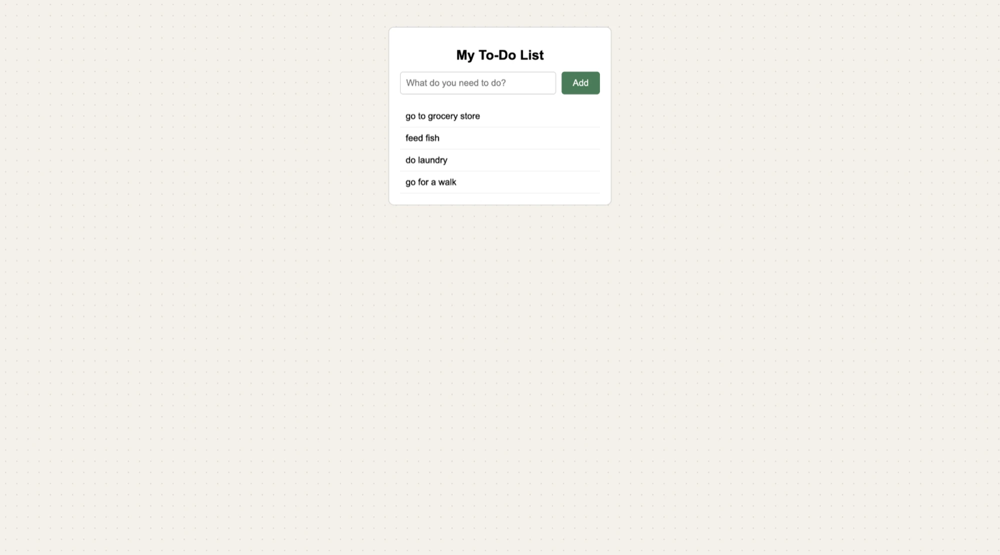

# To-Do List 📝

A simple page where you type in tasks and add them to a list.

## Description

This is a project I built to practice working with the page using JavaScript. You type what you need to do into the box, click **Add**, and the task shows up in your list. It uses plain HTML, CSS, and JavaScript, so there is no server to run. The page is a white card on a dotted cream background.

## Screenshot

## Features

- Type a task and click **Add** to put it on the list
- The box clears after each task so you can add the next one
- Extra spaces around a task are removed
- An empty task is ignored, so you can't add a blank line
- Works on phones, because the card shrinks to fit narrow screens

## Tech Used

- HTML
- CSS
- JavaScript

## How to Use

This app doesn't need a server or an API key.

1. Download or clone the project.
2. Open `index.html` in your browser (or use the Live Server extension in VS Code).
3. Type a task in the box.
4. Click **Add**.

## How It Works

1. When you click **Add**, `main.js` reads what you typed and trims off extra spaces.
2. If nothing is left, it stops and does nothing.
3. Otherwise it creates a new list item (`li`) with the task as its text.
4. It adds the item to the list on the page and clears the box.

## What I Learned

- How to select elements on the page with `querySelector`
- How to listen for a click with `addEventListener`
- How to read and clear the value of an input
- How to check for empty input
- How to style a card with CSS and make it work on small screens

VIEW APP HERE: https://todo-list-uyl0.onrender.com

## Author

Maya Rose 🌹
